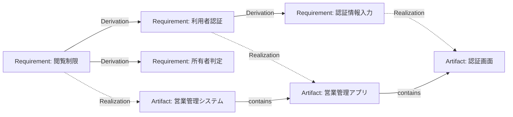

# Domain Model — Engraph Core

## 概念

| 概念 | 責務 |
| --- | --- |
| Requirement | 目的、動機、要求、要件、仕様、条件、制約。対象がなくても存在できる |
| Derivation | あるRequirementから別のRequirementが導出される関係 |
| Artifact | 開発によって定義・具体化される成果物。構想段階のものも含む |
| Realization | Requirementと、その要求を実現するものとして割り当てたArtifactの対応 |
| Validation | Requirement間の導出が適切かを確認する評価 |
| Verification | Realizationが要求を満たすかを確認する評価 |
| Event | 動的な振る舞い。自己参照による分解を想定するが、Artifactとの接続方法は未確定 |

**重要:** RequirementはArtifactに所有される必要はない。Realizationは充足済みの証明ではない。導出元の動機・目的もRequirementであり、Derivationにrationaleカラムは置かない。

## 関係

Artifactの包含ツリーとRequirementの導出グラフは一致しない。複数の要求が同一Artifactに対応し、同一要求が複数のArtifactに対応することもある。

## 最小論理テーブル案

物理スキーマは未確定。以下は現在の合意を表す最小構成であり、追加カラムや評価履歴の扱いは実装時に検討する。

### requirements

| カラム | 型 | 制約 |
| --- | --- | --- |
| id | UUID | PK |
| description | TEXT | NOT NULL |

### derivations

| カラム | 型 | 制約 |
| --- | --- | --- |
| source_id | UUID | PK, FK → requirements.id |
| requirement_id | UUID | PK, FK → requirements.id |

複合PK `(source_id, requirement_id)`。1対多・多対1の導出を表現できる。自己導出・循環を禁止する。

### artifacts

| カラム | 型 | 制約 |
| --- | --- | --- |
| id | UUID | PK |
| parent_id | UUID | NULL, FK → artifacts.id |
| name | TEXT | NOT NULL |
| type | TEXT | NULL |
| description | TEXT | NULL |

`parent_id` で包含階層を表す。循環は禁止。`type` は分類用のデータであり、Coreの固定サブタイプではない。

### realizations

| カラム | 型 | 制約 |
| --- | --- | --- |
| requirement_id | UUID | PK, FK → requirements.id |
| artifact_id | UUID | PK, FK → artifacts.id |

複合PK `(requirement_id, artifact_id)`。対象未定のRequirementにはRealizationがなくてよい。

### validations

| カラム | 型 | 制約 |
| --- | --- | --- |
| id | UUID | PK |
| source_id | UUID | FK |
| requirement_id | UUID | FK |
| result | TEXT | NOT NULL |

`(source_id, requirement_id)` はderivationsへの複合FK。導出関係に対する評価履歴を保持できる。

### verifications

| カラム | 型 | 制約 |
| --- | --- | --- |
| id | UUID | PK |
| requirement_id | UUID | FK |
| artifact_id | UUID | FK |
| result | TEXT | NOT NULL |

`(requirement_id, artifact_id)` はrealizationsへの複合FK。Realizationに対する評価履歴を保持できる。

### events（暫定）

| カラム | 型 | 制約 |
| --- | --- | --- |
| id | UUID | PK |
| parent_id | UUID | NULL, FK → events.id |
| name | TEXT | NOT NULL |
| description | TEXT | NULL |

Eventは概念として維持するが、Realizationとの対応、Artifactとの参加関係、時系列の表現はまだ設計しない。未確定部分を汎用Relationshipで埋めない。

## レコード例：営業活動の閲覧制限

### requirements

| id | description |
| --- | --- |
| R1 | 営業担当者は自分の営業活動だけ閲覧できる |
| R2 | 利用者を認証できる |
| R3 | 営業活動の所有者を判定できる |
| R4 | 認証情報を入力できる |

### derivations

| source_id | requirement_id |
| --- | --- |
| R1 | R2 |
| R1 | R3 |
| R2 | R4 |

### artifacts

| id | parent_id | name |
| --- | --- | --- |
| A1 | NULL | 営業管理システム |
| A2 | A1 | 営業管理アプリ |
| A3 | A2 | 認証画面 |

### realizations

| requirement_id | artifact_id |
| --- | --- |
| R1 | A1 |
| R2 | A2 |
| R4 | A3 |

R3にはまだRealizationがなく、割り当て未決定として把握できる。R1がA1に割り当てられていても、R1の充足は未検証である。

## 今後の検討事項

- Eventの実現・参加・順序を、単純さを維持しながらどう扱うか。
- Artifactの「決定済みの性質」を説明文以外でどう表すか。Propertyの再導入は既定路線としない。
- Validationで個々の導出だけでなく、導出された要求群の十分性をどう評価するか。
- 検証・妥当性確認の方法、証拠、履歴、状態をどこまで持つか。
- 一つの要求に複数Artifactが割り当てられたときの充足判定。

この文書は合意済みの中核と未決定事項を区別する。追加の抽象化は具体例で必要性を確認してから導入する。
